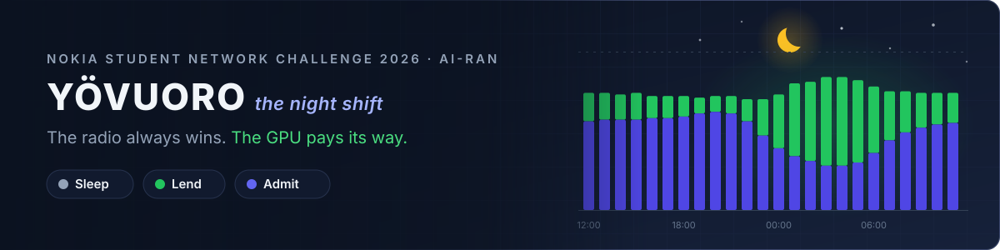
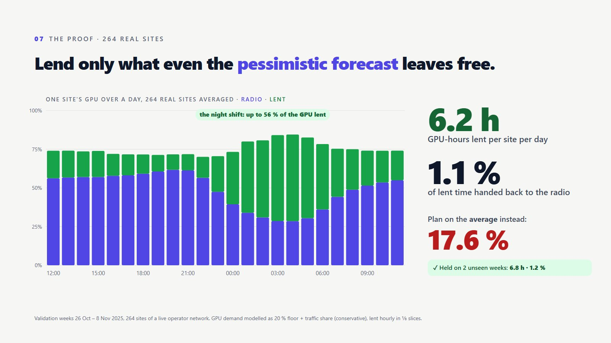
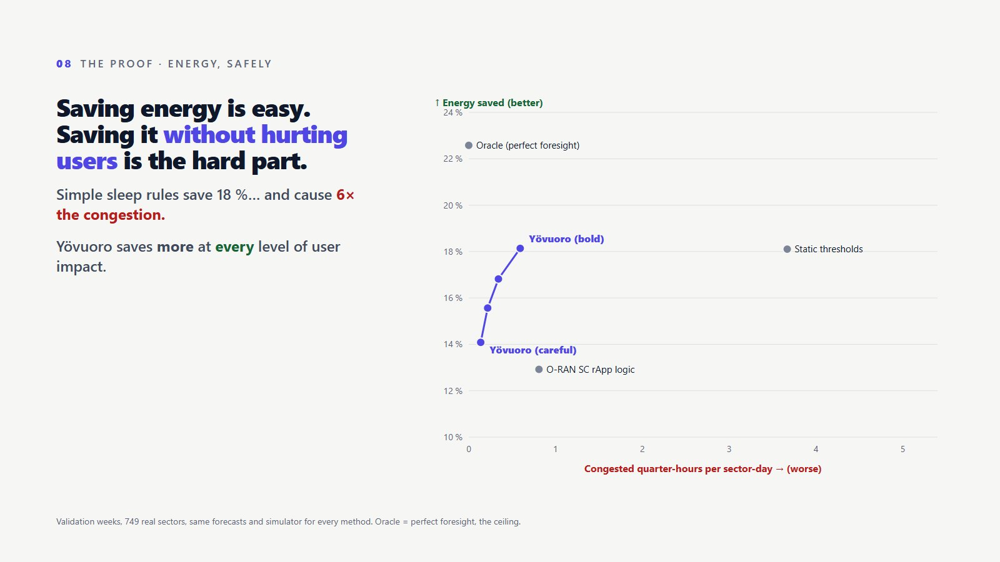
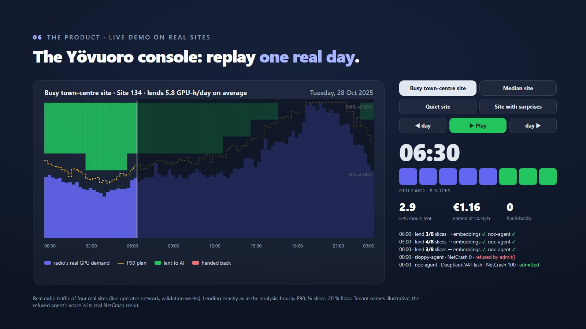
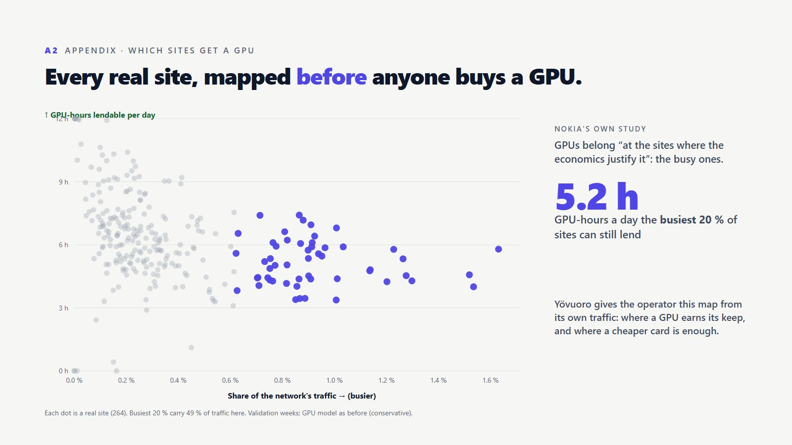
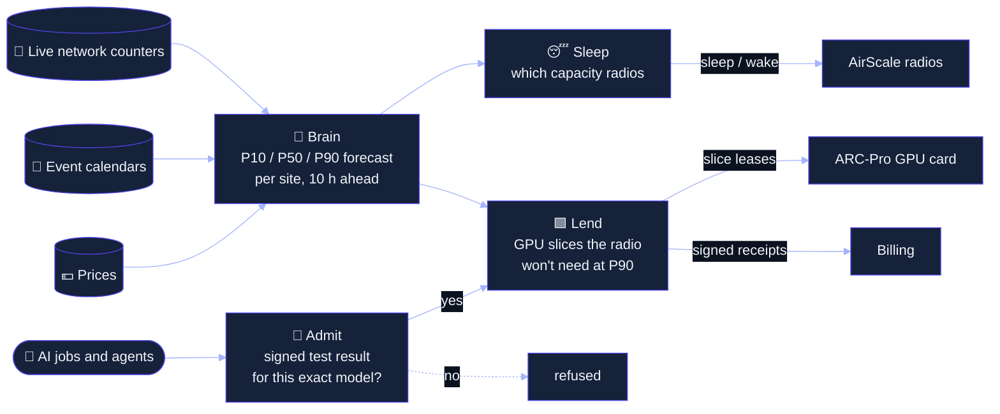

<div align="center">



<br>


[**🌙 Live pitch**](https://yovuoro.vercel.app) · [**📄 Report**](https://yovuoro.vercel.app/report.html) · [**Overview**](#-overview) · [**Product**](#-the-product) · [**Results**](#-results) · [**How it works**](#%EF%B8%8F-how-it-works) · [**Run it**](#-run-it) · [**Repo map**](#%EF%B8%8F-repository-map)

</div>

---

## 🎯 Overview

*Yövuoro* is Finnish for "night shift" (say it *YUH-vwo-ro*). At night both the radios and the base-station GPU sit idle. For every site and every quarter-hour, Yövuoro decides whether to **serve**, **sleep** the capacity radios, or **lend** spare GPU slices, planning on the pessimistic (P90) forecast so the radio always comes first.

| | |
|---|---|
| **Problem** | Nokia is putting Nvidia GPUs into its future RAN. Operators push back: too much power, too much cost, and *"zero benefits"* (Orange CTO, 23 Nov 2026). Lending idle GPU time to AI workloads would fix it, but nobody wants to risk the radio for it. |
| **Goal** | Turn the GPU in every AI-RAN site from a cost into a number in every deal, without a single user noticing. |
| **The twist** | Plan on the **pessimistic** forecast, not the average. That one choice cuts GPU hand-backs from 17.6 % to 1.1 %, so lending stops being a risk to the radio. |
| **Live** | [yovuoro.vercel.app](https://yovuoro.vercel.app) (step with → / space) · [technical report](https://yovuoro.vercel.app/report.html) · [report PDF](Yovuoro_report.pdf) · [pitch PDF](Yovuoro_pitch.pdf) |
| **Built for** | Nokia Student Network Challenge, Turku, 24 Nov 2026 · AI challenge |
| **Built by** | Team EDISS #1 · [Frank Ponce](https://github.com/FrankPonce) · [frankponce.dev](https://frankponce.dev) |
| **Stack** | Python 3.12 · uv · LightGBM quantile forecaster · exact DP planner · MCP · in-toto attestations · Blender Cycles (isometric renders) · vanilla HTML/CSS/JS · Vercel |

| Lend only what even the pessimistic forecast leaves free | Saving energy without hurting users |
|---|---|
|  |  |
| **The console: replay one real day** | **Every real site, mapped before anyone buys a GPU** |
|  |  |

<sub>Slides from the live pitch. Real live-network data (Lehoczký et al., *Scientific Data* 2026); GPU demand modelled from traffic, as stated on each slide.</sub>

---

## 🧩 The product

**Yövuoro is software**: an rApp on Nokia's MantaRay SMO, licensed per site per year and sold by Nokia inside the AI-RAN deal. No new hardware. Three pillars on one brain:

| Pillar | What it does | Result |
|---|---|---|
| 😴 **Sleep** | Switches off capacity radios nobody needs, wakes them before the rush | **18.1 %** radio energy saved at a sixth of static rules' congestion |
| 🟩 **Lend** | Rents the GPU slices the radio won't need to AI jobs, hour by hour; hands them back when traffic returns | **6.2 GPU-h** / site / day, **1.1 %** handed back |
| 🛂 **Admit** | Only AI jobs and agents that passed crash tests on their exact model get on; every lease gets a signed receipt | untested agents refused |
| 🧠 *Brain* | *A cautious (P90) forecast of every site's traffic, 10 hours ahead* | *P10–P90 coverage 80–84 %* |

**In:** live network counters, event calendars, prices. **Out:** sleep/wake commands to AirScale radios, GPU slice leases to the ARC-Pro card, signed receipts to billing.

---

## 📊 Results

Real live-network data, **749 sectors / 264 sites**, validation weeks 26 Oct – 8 Nov 2025.

| | Result | Basis |
|---|---|---|
| ⚡ Radio energy saved | **18.1 %** vs always-on, 6× less congestion than static rules | measured radio energy |
| 🟩 GPU lent | **6.2 GPU-hours / site / day**, **1.1 %** evicted (planning on the average: 17.6 %) | modelled GPU demand ∝ traffic (NG1) |
| 📉 If the radio peaks at 40 % of the GPU (as measured in the literature) | **15.3 GPU-hours**, 0.65 % evicted | [`results/headroom.json`](results/headroom.json) |
| 🌙 Night GPU lent | up to **56 %** of the GPU at 03:00–05:00 | same model |
| 🏙️ Busiest 20 % of sites | still **5.2 GPU-hours / day** | [`results/site_map.json`](results/site_map.json) |
| 🔒 **Locked test weeks** (9–22 Nov, never seen) | **6.8 GPU-h / site / day, 1.2 % evicted**; forecast coverage 80–81 % | [`results/gpu_test.json`](results/gpu_test.json), [`results/forecast_test_report.json`](results/forecast_test_report.json) |
| ⚽ Event agent | **92 %** of the derby's extra congestion removed by reading the calendar | synthetic surge on real traffic |
| 💶 LLM cost | **€0.04** per 31-sector night | measured |

> [!IMPORTANT]
> **The numbers held on data nobody had looked at.** The locked test weeks were run once, with the method frozen on the validation weeks: 6.8 GPU-hours lent per site per day with 1.2 % handed back, against 6.2 h and 1.1 % on validation.

What went right, what went wrong and why each choice was made is logged in [docs/FINDINGS.md](docs/FINDINGS.md) and [docs/DECISIONS.md](docs/DECISIONS.md).

---

## ⚙️ How it works



1. **Forecast cautiously.** A quantile forecaster predicts every site's traffic ten hours ahead as a range. Yövuoro plans on the pessimistic end (P90), so the radio's share is reserved before anything is lent.
2. **Sleep what nobody needs.** An exact planner chooses which capacity radios sleep each quarter-hour and wakes them before the rush; a watchdog wakes them at once if quality slips.
3. **Lend the rest, hour by hour.** GPU slices the radio won't need even at P90 are leased to AI jobs; if traffic comes back, they are handed back to the radio.
4. **Admit only tested AI.** Tenants and agents get on only with a signed test result (NetCrash, in-toto) for their exact model; every lent slice-hour gets a signed receipt.

---

## 🚀 Run it

**See the pitch locally** (needs [uv](https://docs.astral.sh/uv/)):

```bash
uv run --no-project python -m http.server 8779
# then open http://localhost:8779/site/index.html
```

**Reproduce the numbers.** The analysis runs on [Yövahti](https://github.com/FrankPonce/yovahti)'s real-data world and forecasts:

```bash
git clone https://github.com/FrankPonce/yovahti ../yovahti   # then run its data pipeline (see its README)
uv run --project ../yovahti python analysis/night_shift.py    # GPU lending, validation weeks
uv run --project ../yovahti python analysis/headroom.py       # sensitivity to the radio's GPU share
uv run --project ../yovahti python analysis/site_map.py       # which sites deserve a GPU
uv run --project ../yovahti python analysis/fit_test.py       # locked test weeks: forecasts, run once
uv run --project ../yovahti python analysis/gpu_test.py       # locked test weeks: GPU lending
```

Each script writes its JSON to [`results/`](results/).

---

## 🗂️ Repository map

```
site/                   the pitch (animated scroll story, step with → / space) and report.html
  data/                 demo.json, sites.json, dashboard.json: real per-site data for the console and map
  img/                  isometric renders (WebP), logo, report figures
analysis/               night_shift.py · headroom.py · site_map.py · fit_test.py · gpu_test.py · export_demo.py
results/                every number in this README, as JSON
tools/                  render_scenes.py (Blender scenes) · web_images.py (WebP trim) · export_pdf.py (backup PDF)
docs/                   ROADMAP · FINDINGS · DECISIONS · SOURCES
assets/                 README banner
Yovuoro_report.pdf      full technical report
Yovuoro_pitch.pdf       the pitch as PDF
```

| | |
|---|---|
| [Roadmap](docs/ROADMAP.md) | Today's pitch and the product we would build with Nokia |
| [Findings](docs/FINDINGS.md) | Eurekas and gotchas, dated |
| [Decisions](docs/DECISIONS.md) | Every real choice, why, and what else was considered |
| [Sources](docs/SOURCES.md) | Every external source, accessed 24 Nov 2026 |

---

## 🙏 Credits

- Built on [**Yövahti**](https://github.com/FrankPonce/yovahti), an open-source research prototype: forecaster, planner, MCP server, NetCrash, `admit()` and attestations ([agent-trust-kit](https://github.com/FrankPonce/agent-trust-kit) compatible).
- **Live RAN PM counters:** Lehoczký et al., "Performance Management Counters from Live 5G, 4G and 2G Radio Access Network", *Scientific Data* (2026), [doi:10.1038/s41597-026-07723-0](https://www.nature.com/articles/s41597-026-07723-0), CC BY 4.0.
- Isometric scenes modelled in code and rendered in Blender Cycles; no downloaded models.
- Not affiliated with Nokia, Nvidia or Orange.

<div align="center"><sub>Team EDISS #1 · Built in Turku, Finland · 2026</sub></div>
